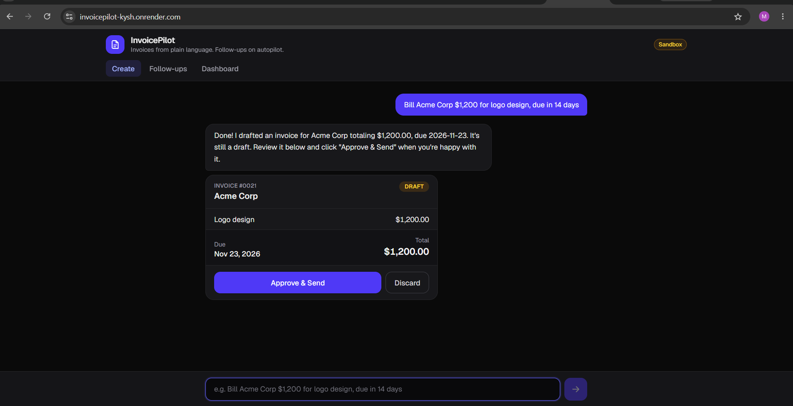
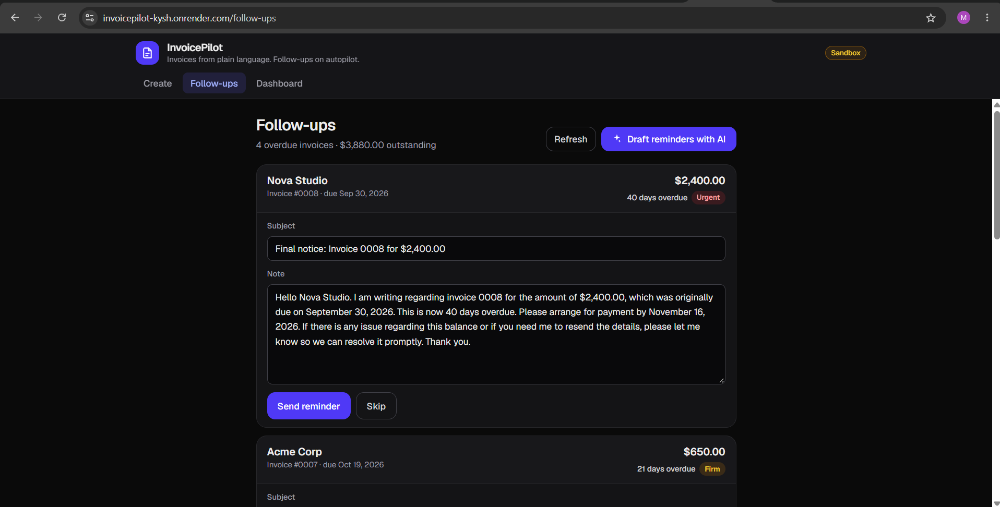
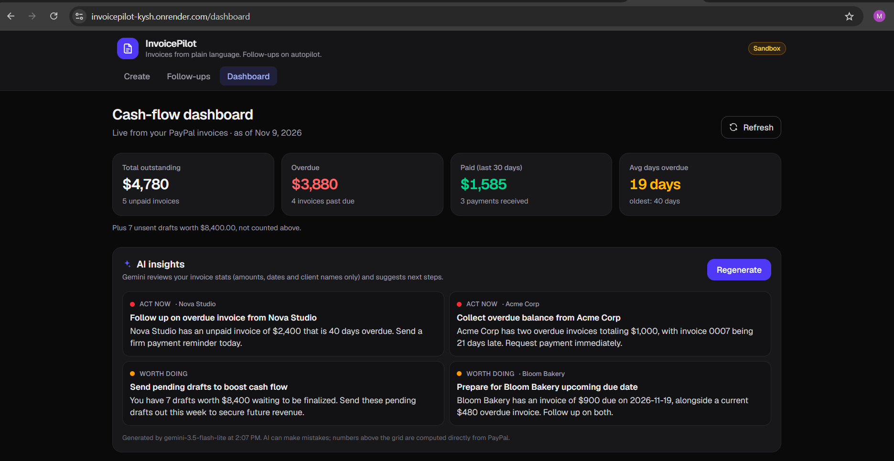
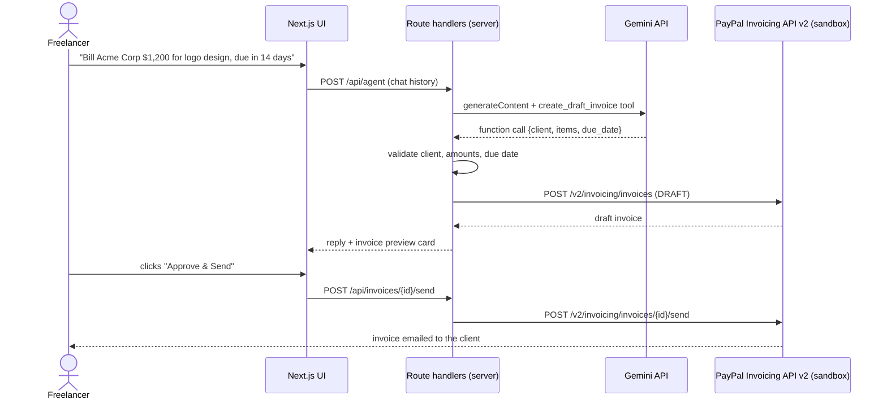

# InvoicePilot

**An AI co-pilot for freelancers that turns plain language into PayPal invoices, chases late payments with the right tone, and shows where your cash is stuck.**

### 👉 [Live demo: https://invoicepilot-kysh.onrender.com](https://invoicepilot-kysh.onrender.com)

> The demo runs on Render's free tier. The first visit can take **up to a minute** while the server wakes up; after that it's fast.
> Everything runs against the **PayPal sandbox**: no real money moves.

Built for the **PayPal AI Hackathon** with Next.js, Google Gemini, the PayPal Invoicing API v2 and AG Grid.

---

## Contents

- [The problem](#the-problem)
- [Features](#features)
- [How it works](#how-it-works)
- [Tools used](#tools-used)
- [Design decisions](#design-decisions)
- [Run it locally](#run-it-locally)
- [Limitations and next steps](#limitations-and-next-steps)
- [License](#license)

---

## The problem

Freelancers and solo businesses do the work, then become their own billing department. Creating invoices takes clicks and context switching. Chasing late payments is worse: it's awkward, easy to forget, and every week of delay hurts cash flow. Most freelancers either send reminders too late, too harshly, or not at all.

**InvoicePilot is for** designers, developers, writers, consultants: anyone who bills a handful of clients through PayPal and would rather spend their time on the work than on admin.

---

## Features

### 1. Natural-language invoicing, with human approval

Type *"Bill Acme Corp $1,200 for logo design, due in 14 days"*. A Gemini agent extracts the client, line items and due date (resolving "in 14 days" or "next Friday" to a real date), creates a **draft** PayPal invoice, and shows a preview card. Nothing is sent until you click **Approve & Send**. If the client or amount is missing or ambiguous, the agent asks one short clarifying question instead of guessing.



### 2. AI late-payment chaser with tone escalation

The **Follow-ups** view lists every overdue invoice with an urgency badge. One click drafts reminders for **all** of them in a single AI call, with tone that escalates by how late the payment is:

| Days overdue | Tone |
|---|---|
| 1 to 7 | Friendly and casual |
| 8 to 30 | Polite but firm |
| 31+ | Firm and professional, with a clear "please pay by" date |

Every reminder names the invoice number, amount and original due date, is always courteous (never threatening), and stays fully editable. You review each one and choose **Send reminder** or **Skip**.



### 3. Cash-flow dashboard (AG Grid) with AI insights

- **KPI cards:** total outstanding, overdue amount, paid in the last 30 days, average days overdue.
- **Invoice grid:** every PayPal invoice, with status badges, overdue highlighting, filters, search, a totals row and CSV export. Row actions jump straight to a reminder (overdue) or send a draft.
- **Client grid:** total billed, outstanding, late invoices, average days late and a **payment reliability** label (Reliable / Sometimes late / Often late) computed from real payment history.
- **AI insights**, on demand: 3 to 4 specific, actionable suggestions such as *"Collect $2,400 overdue from Nova Studio: send a firm reminder today."*



---

## How it works

A Next.js App Router app. The browser never talks to Gemini or PayPal directly: all calls go through server-side route handlers, which hold the API keys and validate everything the AI proposes.



The Follow-ups and Dashboard views follow the same pattern: server routes read invoices from PayPal, compute ages and stats in code, and send Gemini only what it needs for one structured-JSON call.

| Layer | Technology |
|---|---|
| Frontend | Next.js 16 (App Router), React 19, TypeScript, Tailwind CSS 4, AG Grid Community 36 |
| Backend | Next.js route handlers (`app/api/*`) |
| AI | Google Gemini via the official `@google/genai` SDK |
| Payments | PayPal Invoicing API v2 (sandbox) |
| Hosting | Render (free tier) |

Key files: [`lib/agent.ts`](lib/agent.ts) (chat agent), [`lib/gemini.ts`](lib/gemini.ts) (retries, fallback, timeouts), [`lib/paypal.ts`](lib/paypal.ts) (PayPal client), [`lib/reminders.ts`](lib/reminders.ts), [`lib/insights.ts`](lib/insights.ts), [`lib/stats.ts`](lib/stats.ts), [`app/components/dashboard/`](app/components/dashboard/).

---

## Tools used

### Google Gemini

- **SDK and models:** official `@google/genai` SDK. The primary model comes from `GEMINI_MODEL` (Flash-class models; defaults to `gemini-3.8-flash`), with an ordered list of fallbacks in `GEMINI_FALLBACK_MODELS`.
- **Function calling:** the chat agent has one tool, `create_draft_invoice(client_name, items[], due_date?, note?)`. The saved client list and today's date are in the system prompt, so a typical request needs **one** Gemini call: the model calls the tool, the server creates the draft and writes the confirmation itself.
- **Structured JSON output:** reminders and insights use `responseMimeType: "application/json"` with a JSON schema. All overdue reminders are drafted in **one** call; insights are **one** call over pre-computed stats. Output is validated, and any invoice the model skips falls back to a plain template.
- **Reliability** ([`lib/gemini.ts`](lib/gemini.ts)):
  - each call has a **12 s timeout** (AbortController);
  - **1 retry** per model (about 1 s backoff) on 429, 5xx, timeouts and network errors;
  - then the **next fallback model** is tried;
  - each request has an overall **30 s budget**, after which the user sees a friendly error;
  - every attempt is logged with model, attempt number and duration.
- **Minimal thinking for speed:** these are extraction and writing tasks, not deep reasoning, so thinking is set to the minimum: `thinkingBudget: 0` on Gemini 2.x and `thinkingLevel: MINIMAL` on Gemini 3.x.

### PayPal APIs

All calls go to `https://api-m.sandbox.paypal.com` from the server.

| Endpoint | Used for |
|---|---|
| `POST /v1/oauth2/token` | Client-credentials OAuth (token cached until shortly before expiry) |
| `POST /v2/invoicing/invoices` | Create draft invoices (`Prefer: return=representation`) |
| `POST /v2/invoicing/invoices/{id}/send` | Send an approved draft to the client |
| `GET /v2/invoicing/invoices/{id}` | Read status after sending; fetch payment dates for paid invoices |
| `GET /v2/invoicing/invoices?page_size=100&total_required=true` | List all invoices (paged) for Follow-ups and the Dashboard |
| `POST /v2/invoicing/invoices/{id}/remind` | Send an approved payment reminder (subject + note) |
| `POST /v2/invoicing/invoices/{id}/payments` | Record payments (seed script only, to create realistic payment history) |
| `DELETE /v2/invoicing/invoices/{id}` | Clean up a draft if seeding fails halfway (seed script only) |

### AG Grid (Community)

AG Grid Community v36, with only the 14 modules we use registered through `AgGridProvider` (plus the validation module in development), instead of `AllCommunityModule`. See [`grid-setup.tsx`](app/components/dashboard/grid-setup.tsx).

- **Theming API:** `themeQuartz` re-skinned with the app's palette, plus a `dark` theme mode that follows the OS colour scheme, so the grid matches the rest of the app in light and dark.
- **Custom cell renderers:** status badges, reliability badges, and an Actions cell ("Draft reminder" for overdue invoices, a two-step "Send" for drafts).
- **Filtering:** text, number and date column filters (date filters use a comparator for PayPal's `YYYY-MM-DD` strings), a **quick filter** search box, and status chips built on the **external filter** API.
- **Pinned bottom totals row** that recalculates for the currently filtered rows, plus pinned left and right columns.
- **Conditional styling:** `rowClassRules` tint overdue rows and mute paid ones; `cellClassRules` colour "days overdue" by the same tiers as the reminder tones.
- **Sorting:** default sort is most overdue first; status sorts by urgency rather than alphabetically.
- **Responsive layout:** flex column sizing with minimum widths; on phones, less important columns hide and Actions is no longer pinned.
- **Pagination** above 20 rows, **CSV export**, and **tooltips** (e.g. why a client is "Often late").

### Render

The app is deployed as a Node web service on Render's free tier (`npm run build`, then `npm start`), with the same environment variables as `.env.local` set in the Render dashboard, plus `NODE_VERSION=24` to pin the Node runtime (`package.json` requires `>=22.18`). Free instances sleep when idle, which is why the first visit can be slow.

To keep the public demo usable for everyone (and within free-tier quotas), routes that call Gemini or send emails through PayPal are rate-limited to **20 requests per 10 minutes per IP address**, per route.

---

## Design decisions

- **Human in the loop.** The AI can only create **drafts**. Sending an invoice or a reminder always takes an explicit click, and the agent is instructed never to claim something was sent.
- **AI tool calls are validated on the server.** Before anything reaches PayPal, the server checks that the client is a saved client, that quantities and amounts are positive numbers, and that the due date is a real date and not in the past. If a check fails, the model gets the error and asks the user instead.
- **One draft per message.** A guard stops the agent from creating duplicate invoices within one request. Retries only ever repeat the Gemini call, never a PayPal action that already ran.
- **Emails never reach the AI.** Client emails are stripped before any data is sent to Gemini; insights get aggregated numbers and client names only.
- **Model fallback for reliability.** Free-tier models are sometimes overloaded (503) or rate-limited (429). The app retries, then falls back to other models, within a fixed time budget.
- **Facts in code, wording by AI.** Days overdue, tone tiers, KPIs and payment-reliability labels are calculated in code. AI is used for language (reminders, insights), not arithmetic.
- **Reminders are checked before sending.** The send route confirms with PayPal that the invoice is really overdue and the note isn't empty.

---

## Run it locally

### Prerequisites

- **Node.js 22.18 or newer** (Node 24 recommended). The Gemini SDK needs Node 22+, and the seed script uses Node's built-in TypeScript support.
- A free **PayPal Developer** account: <https://developer.paypal.com>
- A free **Gemini API key** from Google AI Studio: <https://aistudio.google.com/apikey>

### 1. Clone and install

```bash
git clone https://github.com/Mugilan718/invoicepilot.git
cd invoicepilot
npm install
```

### 2. Create PayPal sandbox credentials

1. In the PayPal Developer Dashboard, go to **Apps & Credentials** (Sandbox) and create an app.
2. Copy its **Client ID** and **Secret**.

### 3. Create a US Personal sandbox account (the invoice recipient)

All demo clients send their invoices to one sandbox **personal** account, so you can see the emails arrive.

1. Go to **Testing Tools > Sandbox Accounts > Create account**.
2. Choose **Personal** and set the country to **United States**.
3. Use this account's email as `PAYPAL_TEST_CUSTOMER_EMAIL`.

> **Important:** PayPal blocks sending invoices to recipients in India (`INR_FOREIGN_CURRENCY_BLOCKED`). Creating drafts works, but **sending fails** if the recipient account is registered in India. Use a US (or other non-India) personal account.

### 4. Get a Gemini API key

Create a free key in Google AI Studio. The free tier is enough for the demo.

### 5. Create `.env.local`

Create `.env.local` in the project root (it's git-ignored). Use your own values; never commit real keys.

```env
# PayPal sandbox app credentials
PAYPAL_CLIENT_ID=your_sandbox_client_id
PAYPAL_CLIENT_SECRET=your_sandbox_secret

# Sandbox PERSONAL account (US) that receives the demo invoices
PAYPAL_TEST_CUSTOMER_EMAIL=your_us_personal_sandbox_email

# Gemini
GEMINI_API_KEY=your_gemini_api_key
# Primary model (optional; defaults to gemini-3.8-flash)
GEMINI_MODEL=gemini-2.5-flash
# Optional comma-separated fallbacks, tried in order if the primary is busy
GEMINI_FALLBACK_MODELS=gemini-3.5-flash-lite,gemini-3.1-flash-lite

# Optional: pretend "today" is this date (YYYY-MM-DD) for overdue math.
# Only needed if PayPal rejects past due dates when seeding; the UI shows a "Demo date" badge.
# DEMO_TODAY=2026-12-23
```

Model names change over time. If a model isn't available to your key, pick another Flash model listed in Google AI Studio.

### 6. Seed demo data

```bash
npm run seed           # 5 sent invoices: 4 overdue (3 to 40 days) and 1 not yet due
npm run seed:history   # 8 past invoices with recorded payments (on time and late)
```

- `seed` tries real past due dates first. If PayPal rejects them, it switches to future dates and prints a `DEMO_TODAY=...` line to add to `.env.local`.
- `seed:history` gives the dashboard its "Paid (last 30 days)" figure and the client reliability labels.
- Each run creates **new** sandbox invoices, so run each one once.

### 7. Start the app

```bash
npm run dev
```

Open <http://localhost:3000> and try:

- **Create:** *"Bill Acme Corp $1,200 for logo design, due in 14 days"*, then **Approve & Send**.
- **Follow-ups:** **Draft reminders with AI**, edit one, then **Send reminder**.
- **Dashboard:** filter and sort the grid, export CSV, then **Generate insights**.

---

## Limitations and next steps

**Current limitations (it's a hackathon prototype):**

- **Sandbox only.** All PayPal calls use the sandbox; no real money moves.
- **No user login.** The send and remind routes are open. In production they need authentication and a check that the invoice belongs to the signed-in user.
- **Fixed demo clients.** Three demo clients (Acme Corp, Bloom Bakery, Nova Studio) come from `data/clients.json`, and all share one sandbox recipient email.
- **Free-tier limits.** Gemini free-tier rate limits can cause slow or failed AI requests at busy times (mitigated by retries and model fallback), and the Render free tier sleeps when idle.
- **USD only**, and "Reminder sent" status is shown for the current session only (PayPal doesn't expose reminder history).

**Next steps:**

- Sign-in (e.g. Log in with PayPal) and per-user data.
- A real client address book, with clients added from chat.
- PayPal **webhooks** (e.g. invoice paid) to update the dashboard instantly instead of polling.
- A scheduled follow-up queue that drafts reminders automatically and waits for one-click approval.
- Multi-currency invoices and payment-plan suggestions for clients who are often late.

---

## License

[MIT](LICENSE)
